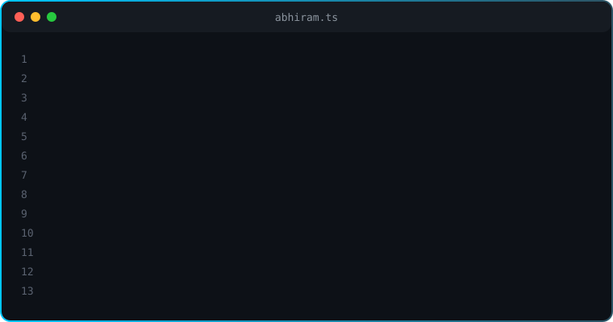

<table>
<tr>
<td width="26%" align="center" valign="middle">

  
<b>Abhiram Kukatla</b>
 
Founder, Zynspark
</td>
<td width="74%">

</td>
</tr>
</table>

## 👋 About me

I'm **Abhiram**, founder of **[Zynspark](https://zynspark.in)**, a digital agency in India building websites, apps and AI tools for businesses.

## 🚀 What I build

<table>
<tr>
<td width="50%" valign="top">
<h3>🌐 Websites and web apps</h3>
Business websites and web apps with TypeScript, React and Next.js.
</td>
<td width="50%" valign="top">
<h3>📱 Mobile apps</h3>
Cross-platform apps built on Expo and Supabase.
</td>
</tr>
<tr>
<td width="50%" valign="top">
<h3>🤖 AI dashboards and automation</h3>
Dashboards and workflows that put AI to work for a business.
</td>
<td width="50%" valign="top">
<h3>🧠 Deep learning</h3>
Image classification and object detection projects.
</td>
</tr>
</table>

## ⭐ Featured work

| Project | What it is |
| :-- | :-- |
| 📊 **[ai-lead-management-dashboard](https://github.com/kuktl/ai-lead-management-dashboard)** | AI lead management dashboard |
| 💍 **[Sri-Lakshmi-All-cast-matrimony](https://github.com/kuktl/Sri-Lakshmi-All-cast-matrimony)** | Matrimony platform |
| 🎨 **[Portfolio](https://github.com/kuktl/Portfolio)** | My portfolio and notebooks |

## 🛠️ Tech

## 📫 Get in touch

